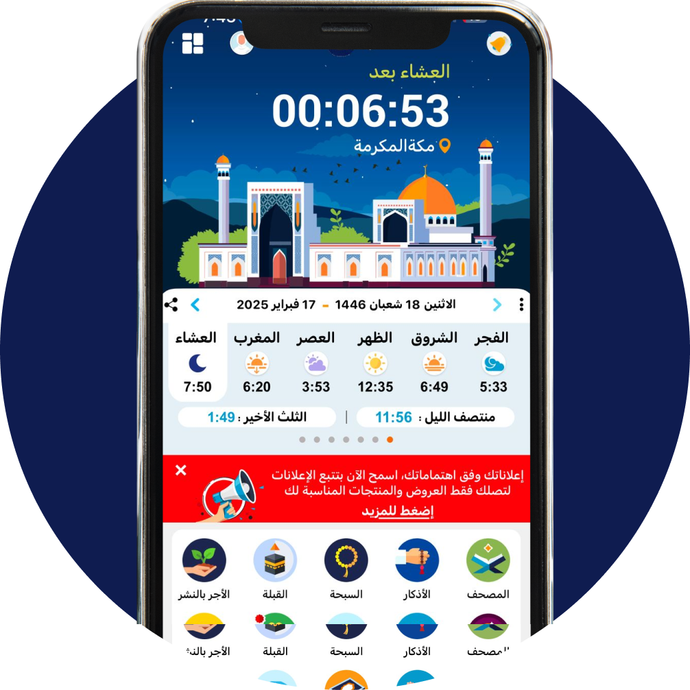
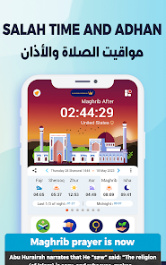
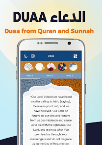

<div align="center">

  

  # تطبيق المصلي | AlMosally Open Source

  **إعادة بناء مفتوحة المصدر لتطبيق المصلي على Android، مع تجربة ويب ثابتة مرافقة.**

  [](../../actions/workflows/android-build.yml)
  [](../../actions/workflows/deploy-website.yml)
  [](LICENSE)
  [](../../releases/latest)
  [](https://www.android.com)

  **موقع المصلي:** [افتح تجربة الويب](https://esraamohan78-source.github.io/almosaly-open-source/) · [تنزيل تطبيق Android](../../releases/latest)

</div>

> ⚠️ **تنويه عن نسخة Android:** هذا المستودع يتضمن إعادة بناء من APK بواسطة Apktool، وليس ملفات المصدر الأصلية Kotlin/Java. يحتوي على Smali وموارد مفككة؛ لذلك تكون صيانته وقراءته أصعب من مشروع Android أصلي. نجاح إعادة البناء لا يثبت أن كل ميزات التطبيق اختُبرت على جميع الأجهزة.

##  موقع الويب

موقع عربي متجاوب وثابت مستضاف على GitHub Pages، تصميمه مستوحى من واجهات المصلي. يوفّر مواقيت الصلاة، والقرآن والتلاوة، والأذكار، والقبلة، والتقويم الهجري، ومتابعة ختمة شخصية. يمكن تثبيته كتطبيق ويب (PWA) من المتصفح.

| الميزة | طريقة عملها وحدودها |
| --- | --- |
| مواقيت الصلاة والأذان | حساب محلي باستخدام طريقة الحساب والمدينة/الإحداثيات التي تختارينها. إشعارات المتصفح اختيارية ولا يُضمن استمرارها عند إغلاق الصفحة. |
| القرآن والتلاوة | تحميل السورة المختارة عند الطلب من AlQuran Cloud؛ يلزم الإنترنت للمحتوى غير المحفوظ. المصدر والشروط موثقان في [`website/SOURCES.md`](website/SOURCES.md). |
| الأذكار | نصوص مختارة مع عدادات يومية محفوظة محليًا وروابط لمصادر النص. |
| اتجاه القبلة | حساب الزاوية داخل المتصفح من الموقع الذي تختارينه، مع دعم حساس الاتجاه إن توفر. |
| التاريخ الهجري | تحويل وفق تقويم أم القرى؛ قد يختلف عن الرؤية أو التقويم الرسمي في بلدك. |
| الختمة والإعدادات | تقدم شخصي ومفضلات وإعدادات في مساحة المتصفح على هذا الجهاز. |

**الموقع نسخة مستقلة بميزات محلية فقط:** لا يوفّر حسابات مستخدمين، أو مجتمعًا متزامنًا، أو مزامنة بين الأجهزة، ولا يتصل بقاعدة بيانات التطبيق. حذف بيانات المتصفح قد يمحو الإعدادات والمفضلات وتقدم الختمة. وقد تختلف بعض وظائف الويب عن Android بسبب قيود المتصفح.

##  لقطات من تطبيق Android

<div align="center">
  
  
</div>

*صور الواجهات للتعريف بالمشروع. مصدر الصور وحقوق استخدامها موضحان في [قسم الترخيص والمصادر](#الترخيص-ومصادر-الصور).*

##  ما يتضمنه المستودع

موارد وواجهات Android مرتبطة بمواقيت الصلاة والتنبيهات والقرآن والتلاوات والأذكار والأدعية واتجاه القبلة والتقويم الهجري. **وجود مورد يحمل اسم ميزة لا يضمن أن الميزة تعمل في النسخة الحالية**؛ تحقق منها على جهاز/محاكي قبل الاعتماد عليها. موقع الويب موثق كمنتج مستقل في [`website/README.md`](website/README.md).

##  هيكل المستودع

| المسار | المحتوى |
| --- | --- |
| `app/AndroidManifest.xml` | تعريف حزمة Android ومكوناتها وأذوناتها |
| `app/smali/` و`app/smali_classes*/` | شيفرة Smali المفككة الحالية |
| `app/res/` | موارد Android، مثل الصور والواجهات والنصوص |
| `app/assets/` و`app/lib/` | أصول ومكتبات إضافية مضمنة في APK |
| `website/src/` | صفحات ومكونات وتجربة الويب المستقلة |
| `website/public/` | الشعار ولقطات التطبيق وملفات PWA وبيان المسارات |
| `website/SOURCES.md` و`website/README.md` | المصادر والتراخيص وتعليمات البناء المحلية |
| `.github/workflows/` | فحوص البناء وإجراءات GitHub Pages |
| `docs/wiki/` | دليل المشروع، ويشمل صفحة عن موقع الويب |
| `scripts/build-release.sh` | إعادة بناء APK ومحاذاته وتوقيعه بمفتاحك |

##  البناء والتشغيل محليًا

### موقع الويب

المتطلبات: Node.js 22 وpnpm 10.

```bash
cd website
pnpm install --frozen-lockfile
pnpm dev
pnpm typecheck
VITE_BASE_PATH=/almosaly-open-source/ pnpm build
```

للتشغيل في بيئة محلية على جذر الموقع يمكن حذف `VITE_BASE_PATH` من أمر البناء. تجد التفاصيل والحدود في [`website/README.md`](website/README.md). يتم بناء ونشر الموقع تلقائيًا عبر [GitHub Actions](.github/workflows/deploy-website.yml) عند تعديل ملفات `website/` بعد إعداد GitHub Pages على المستودع.

### Android

#### المتطلبات

- Java 17 أو أحدث.
- Apktool 2.10.0 أو أحدث.
- Android SDK Build Tools، وتشمل `zipalign` و`apksigner`.
- جهاز Android أو محاكي للتثبيت والاختبار.

#### إعادة البناء

```bash
git clone https://github.com/esraamohan78-source/almosaly-open-source.git
cd almosaly-open-source
apktool b app -o /tmp/almosaly-unsigned.apk
zipalign -f -p 4 /tmp/almosaly-unsigned.apk /tmp/almosaly-aligned.apk
```

الناتج غير موقّع. وقّعه بمفتاح تملكه قبل التثبيت. لإنتاج نسخة موقّعة، عرّف `KEYSTORE_FILE` و`KEY_ALIAS` و`KEYSTORE_PASSWORD` و`KEY_PASSWORD` محليًا، ثم شغّل:

```bash
./scripts/build-release.sh
```

بعد التوقيع والتحقق يمكن تثبيته على جهاز متصل عبر `adb install -r dist/my-muslim-app-release.apk`. راجع [دليل البناء المحلي](docs/wiki/Local-build.md). **لا تضع مفتاح التوقيع أو كلمات مروره في المستودع.**

##  التنزيل

| النسخة | الرابط |
| --- | --- |
| **موقع المصلي على الويب** | [فتح الموقع](https://esraamohan78-source.github.io/almosaly-open-source/) — يمكن تثبيته كتطبيق PWA من المتصفح |
| **تطبيق المصلي المفتوح المصدر — APK** | [تنزيل APK المفتوح مباشرة](https://github.com/esraamohan78-source/almosaly-open-source/releases/download/v1.0.0/my-muslim-app-release.apk) · [صفحة الإصدارات](https://github.com/esraamohan78-source/almosaly-open-source/releases/latest) |
| **التطبيق الرسمي المحدث — Android** | [تنزيل/تحديث من Google Play](https://play.google.com/store/apps/details?id=com.moslay) |

> ملاحظة: رابط Google Play هو القناة الرسمية للتطبيق المحدث. أما APK المفتوح المصدر فهو إصدار إعادة البناء المنشور في هذا المستودع، وقد يختلف عن النسخة الرسمية في الميزات والتوقيع.

إن توقيع APK بمفتاح مختلف عن نسخة مثبتة قد يمنع تحديثها فوق النسخة الحالية؛ راجع ملاحظة التوقيع والأمان أدناه.

##  المساهمة وطلب الدعم

يسعدنا استقبال التوثيق والتصحيحات والتحسينات. ابدأ بقراءة [CONTRIBUTING.md](CONTRIBUTING.md)، ثم استخدم [قالب الإبلاغ عن خطأ](../../issues/new?template=bug_report.yml) أو [قالب اقتراح ميزة](../../issues/new?template=feature_request.yml). لا ترفق أسرارًا أو بيانات شخصية أو مواد لا تملك حق نشرها.

##  Wiki والأسئلة الشائعة

- [الصفحة الرئيسية للـWiki](docs/wiki/Home.md)
- [نظرة عامة على التطبيق](docs/wiki/App-overview.md)
- [تفاصيل هيكل الملفات](docs/wiki/Project-structure.md)
- [خطة ترحيل Android Studio ونتائج JADX](docs/wiki/Android-studio-migration.md)
- [توثيق موقع الويب ومصادره](docs/wiki/Website.md)
- [دليل البناء والتشغيل محليًا](docs/wiki/Local-build.md)
- [الأسئلة الشائعة](docs/wiki/FAQ.md)
- [القيود والمشكلات المعروفة](docs/wiki/Known-issues.md)

##  التوقيع والأمان

كل تحديث قابل للتثبيت فوق نسخة سابقة يحتاج إلى **مفتاح التوقيع نفسه**. مفتاح الإصدار الرسمي غير موجود في هذا المستودع، ولا تُرفع ملفات `.jks` أو `.keystore` أو `key.properties` أو كلمات المرور أو مفاتيح API إلى GitHub. اطّلعي على أذونات APK ومكتباته وخدماته الخارجية قبل توزيعه. الموقع الثابت لا يطلب حسابًا، ولا يرسل موقع الجهاز أو تقدم الختمة إلى خادم الموقع.

##  الترخيص ومصادر الصور

المستودع منشور تحت [MIT License](LICENSE)، وفق تأكيد مالك المشروع أن الكود والموارد المضمنة مملوكة له أو لديه إذن بنشرها. لا يعني ذلك أن العلامات التجارية أو صور التطبيق أو مواد الأطراف الثالثة أصبحت ملكًا للمشروع؛ تحققي من تراخيص المكتبات والموارد قبل إعادة التوزيع.

صور واجهات تطبيق Android وشعاره مأخوذة من أصول هذا المستودع وصفحة [المصلي على Google Play](https://play.google.com/store/apps/details?id=com.moslay). صور الويب وحقوق محتوى القرآن والتلاوة والأذكار ومكتبة الحساب الفلكي موضحة في [`website/SOURCES.md`](website/SOURCES.md). يرجى مراجعة شروط المصادر وحقوق استخدامها قبل توظيفها خارج هذا المشروع.
